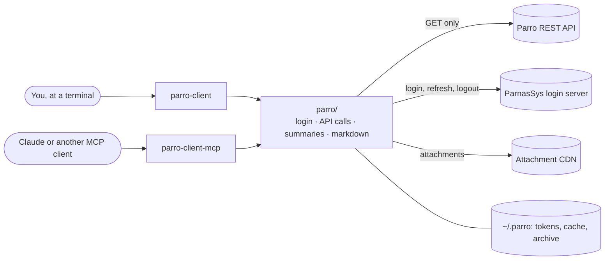
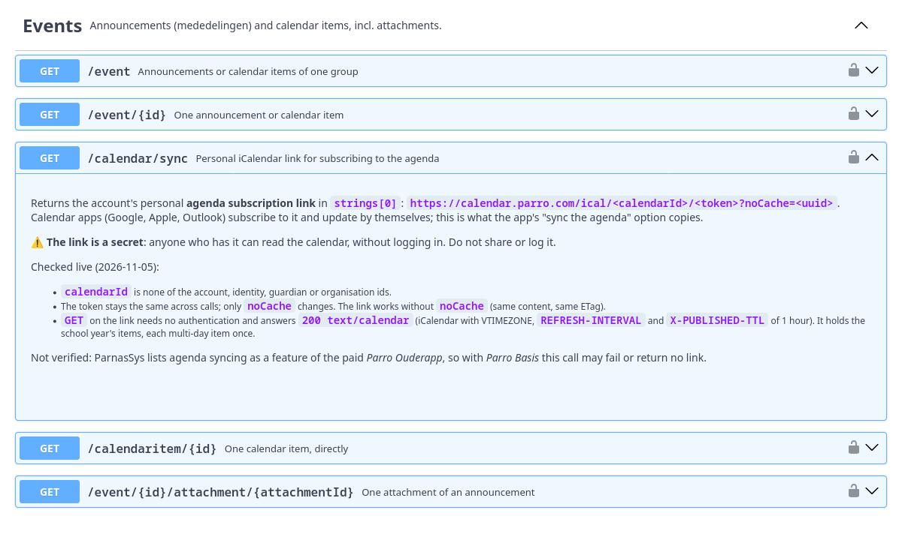

# Parro API client and OpenAPI spec

**Read your child's school news from the terminal or from Claude:** an unofficial, read-only client
and API description for [Parro](https://talk.parro.com), the Dutch parent–school communication app
by Topicus (ParnasSys). It reads announcements, newsletters (**including the text inside PDF
attachments**), the calendar, chats and class info.

[](https://github.com/chris-swift-dev/parro-api-client/actions/workflows/ci.yml)
[](https://github.com/chris-swift-dev/parro-api-client/releases/latest)


[](https://github.com/chris-swift-dev/parro-api-client/blob/main/LICENSE-CODE)
[](https://github.com/chris-swift-dev/parro-api-client/blob/main/LICENSE)

<picture>
  <source media="(prefers-color-scheme: dark)" srcset="https://raw.githubusercontent.com/chris-swift-dev/parro-api-client/main/docs/images/terminal-overview-dark.svg">
  
</picture>

<sub>All pictures in this README show invented example data from the test suite.</sub>

> Not affiliated with or endorsed by Topicus, ParnasSys or Parro. Behaviour was observed, not
> documented by the vendor, and may change at any time. Only documented `GET` endpoints and the
> standard OAuth2 login flow are used and described.

## Quick start

1. Install it, on Windows, macOS or Linux (Python 3.10 or newer). [pipx](https://pipx.pypa.io)
   or [uv](https://docs.astral.sh/uv/) keep it in its own environment and put the commands on your
   PATH:
   ```bash
   pipx install parro-api-client
   ```
   Or `uv tool install parro-api-client`. To read PDF newsletters as text, install
   `"parro-api-client[attachments]"` instead. Straight from GitHub:
   `pipx install git+https://github.com/chris-swift-dev/parro-api-client`.
2. Log in. You type the password; the login then lasts up to 8 hours:
   ```bash
   parro-client login --prompt
   ```
3. See what is new:
   ```bash
   parro-client overview
   ```

Update with `pipx upgrade parro-api-client`. **Without installing anything:** download a release
from the [Releases page](https://github.com/chris-swift-dev/parro-api-client/releases), unpack it,
and run `python3 parro_cli.py` wherever this README says `parro-client`.

For Claude and other MCP clients, see [MCP server](#mcp-server). **API explorers:** the spec is
browsable in **[Swagger UI](https://chris-swift-dev.github.io/parro-api-client/)**.

## What it does

| | |
| --- | --- |
| `parro-client` | a command-line client: readable markdown at a terminal, JSON when piped (`jq`) |
| `parro-client-mcp` | an MCP server over stdio for Claude and other MCP clients |
| `parro/` | the library both use: login, API calls, summaries, attachments |
| `openapi/parro.public.openapi.json` | the OpenAPI 3.0.3 description of the API (contract version 224) |

The Parro web app talks to a Topicus "geon" REST API at `https://rest-v2.parro.com/rest/v2`. This
client speaks that API and adds three things:

1. **It strips the geon boilerplate.** A three-group list is 2.8 KB of JSON carrying about 300 bytes
   of information. Every command returns a compact summary; `--raw` (MCP: `raw: true`) gives the
   untouched payload.
2. **It reads attachments.** Newsletters arrive as PDFs; `attachment` / `parro_attachment` returns
   their text. Photos come back as images (MCP) or can be saved (CLI).
3. **It shows the data the way the app does.** Announcements once each with author and groups, an
   agenda per day, conversations in reading order, an overview of what is new. Every id stays
   visible, so the next command is always at hand.

It only ever **reads**: the Parro API only receives `GET`, and `POST` goes only to the login
server's token, revoke and login-form endpoints. Standard library only; PyMuPDF / pypdf (PDF text)
and Pillow (photo downscaling) are optional.



## What it looks like

At a terminal the CLI prints markdown; piped into another program it prints JSON. `--format` (or
`PARRO_FORMAT`) chooses explicitly. Dates are shown in the school's time zone, labels are English,
content is shown as written. Calendar items that ask parents to help (driving, reading aloud) are
marked *helpers wanted*; with `--details` you see how many signed up, and whether you did.

<details>
<summary><b>The agenda</b>: <code>calendar --details</code></summary>

<picture>
  <source media="(prefers-color-scheme: dark)" srcset="https://raw.githubusercontent.com/chris-swift-dev/parro-api-client/main/docs/images/terminal-calendar-details-dark.svg">
  
</picture>
</details>

<details>
<summary><b>Announcements</b>: <code>announcements</code></summary>

<picture>
  <source media="(prefers-color-scheme: dark)" srcset="https://raw.githubusercontent.com/chris-swift-dev/parro-api-client/main/docs/images/terminal-announcements-dark.svg">
  
</picture>
</details>

[`tests/snapshots/`](https://github.com/chris-swift-dev/parro-api-client/tree/main/tests/snapshots) holds the output of every view.

## Command line

```bash
parro-client --help
parro-client login --prompt              # type the password; the login lasts up to 8 hours
parro-client status
parro-client overview                    # what is new, like the app's home screen
parro-client announcements --limit 5 --unread-only
parro-client attachment <announcement-id> --text
parro-client calendar --details          # agenda with location, description and helper slots
parro-client calendar-link               # Parro's own link to subscribe from Google/Apple/Outlook
parro-client calendar --ics parro.ics --details # or: an .ics file to import
parro-client sync                        # keep a local archive (repeat to update)
parro-client privacy                     # can you still change your children's privacy choices?
parro-client announcements --format json | jq '.announcements[].title'
parro-client get /accountsettings
parro-client token                       # paste into Swagger UI → Authorize → bearerToken
```

Commands: `login [--prompt]`, `logout`, `status`, `token`, `login-url`, `login-finish <url>`,
`overview`, `me`, `children`, `privacy [--link CHILD_ID]`, `groups [--previous]`, `unread`, `system-news [--full]`,
`announcements [--group ID] [--limit N] [--unread-only] [--full]`, `announcement <id>`,
`calendar [--group ID] [--limit N] [--details] [--past] [--ics FILE]`, `calendar-link`,
`attachment <event-id> [--attachment-id ID | --all] [--save-to DIR] [--text]`, `chatrooms`,
`chat-messages <chatroom-id>`, `sync [--to DIR] [--previous] [--photos]`, `cache info|clear`,
`get <path> [--param k=v ...] [--limit N] [--offset N]`.
Global options: `--format auto|json|markdown`, `--login-method`, `--raw`, `--compact`,
`--no-cache`, `--verbose`. `--full` shows whole texts instead of a 3-line preview.

Exit codes: `0` ok · `1` API/network error · `2` usage · `3` not logged in · `4` login halted.

## MCP server

Ask Claude about school, and it reads Parro for you. An illustration with the invented test data:

> **You:** Do I need to do anything for school in the coming weeks?
>
> **Claude** calls `parro_overview`, `parro_calendar {"details": true}` and `parro_announcement`,
> then answers:
> *Two things need a reply: the trip to the Natuurmuseum on Thursday 12 November (group 6 still
> needs two parents who can drive; there is a permission form attached) and the parent–teacher
> talks for group 3 on 17 November (pick a ten-minute slot). Friday 13 November is a study day:
> no school, but the after-school care is open.*

| Tool | What it gives you |
| --- | --- |
| `parro_auth_status` | Login state, account, role, token expiry, whether automatic login is halted. Start here when something fails. |
| `parro_login` | Log in with `PARRO_USERNAME` and the password; optional `method`. |
| `parro_login_url` / `parro_login_finish` | Browser login without a stored password (OAuth2 + PKCE). |
| `parro_logout` | Revoke the tokens at the IdP and forget them. |
| `parro_me` | Account and school. |
| `parro_children` | Children linked to the account. |
| `parro_groups` | Classes and school-wide groups, with the ids other tools need. |
| `parro_announcements` | The main feed. Merges all groups, newest first, full text + attachment list. |
| `parro_announcement` | One announcement by id, with author. |
| **`parro_attachment`** | **Downloads an attachment of an announcement or calendar item and returns its text (PDF/docx/txt/csv/html) or the image.** |
| `parro_calendar` | Calendar items from today on, soonest first; `details: true` adds location, description and helper slots, `past: true` earlier items. |
| `parro_chatrooms` / `parro_chat_messages` | Conversations. |
| `parro_unread` | Unread counts per category. |
| `parro_get` | Escape hatch: GET any `/rest/v2` path not covered above. |
| `parro_overview` | What is new: unread counts, latest announcements, coming up, unread chats. |
| `parro_calendar_link` | The personal link to subscribe to the Parro agenda (keep it secret). |
| `parro_privacy` | Per child: can parents change the privacy choices now, and when were they last changed; `link: true` gives the page to change them (keep it secret). |

Every tool takes an optional `format`: `json` (default) or `markdown`, a readable view that keeps
every id. The first 16 tools have the same names and arguments as the original server, so existing
MCP configurations keep working.

With the package installed (Quick start), Claude Code:

```bash
claude mcp add parro -s user -- parro-client-mcp
```

Claude Desktop (`claude_desktop_config.json`) does not see your shell's PATH, so give the full path
of the command: `which parro-client-mcp` (Windows: `where parro-client-mcp`) prints it.

```json
{
  "mcpServers": {
    "parro": {
      "command": "/Users/you/.local/bin/parro-client-mcp",
      "env": { "PARRO_USERNAME": "you@example.com", "PARRO_PASSWORD_FILE": "/path/to/password-file" }
    }
  }
}
```

Without installing it first, [uv](https://docs.astral.sh/uv/) can start it on demand:
`"command": "uvx", "args": ["--from", "parro-api-client", "parro-client-mcp"]` (also with the full
path of `uvx` for Claude Desktop). From an unpacked release:
`"command": "python3", "args": ["/path/to/parro-api-client/parro_mcp.py"]`.

Testing without an MCP client: `parro-client-mcp tools`, then
`parro-client-mcp call parro_announcements '{"limit": 5}'`. PDF text needs **PyMuPDF** or
**pypdf**, photo downscaling **Pillow** (installed with `"parro-api-client[attachments]"`); without them
everything else works, and the attachment tool says what to install. Running it in Docker:
[DEPLOY.md](https://github.com/chris-swift-dev/parro-api-client/blob/main/DEPLOY.md).

## Logging in

Logging in is OAuth2 against the ParnasSys login server. By default the client does exactly what a
browser does (the login form); tokens are stored in `~/.parro-mcp/tokens.json` (mode 0600) and
refresh themselves, but **a login lasts at most 8 hours**: the login server's limit, however often
the client refreshes. After that, log in again. With `PARRO_USERNAME` and a password file set, the
client (and the MCP server) logs in again on its own when needed: one password check per 8 hours.

> **The login server locks the account after a few failed logins.** When a password is rejected,
> the client stops logging in on its own, so a typo costs one attempt, not one per call. `status`
> then shows `automatic_login_halted`; fix the password and run `parro-client login` once.

Credentials: `PARRO_USERNAME` plus `PARRO_PASSWORD_FILE` (or `PARRO_PASSWORD`), or
`login --prompt`, or no password at all with `login-url` / `login-finish`. Login methods, the
lockout latch and why there is no automatic browser redirect: **[docs/LOGIN.md](https://github.com/chris-swift-dev/parro-api-client/blob/main/docs/LOGIN.md)**.
Every environment variable: **[docs/CONFIGURATION.md](https://github.com/chris-swift-dev/parro-api-client/blob/main/docs/CONFIGURATION.md)**.

## The agenda in your own calendar app

- **`calendar-link`** prints Parro's own subscription link (`GET /calendar/sync`). Paste it into
  Google Calendar (*Other calendars → From URL*), Apple Calendar (*New Calendar Subscription*) or
  Outlook (*Subscribe from web*), and the calendar keeps itself up to date. **The link is a secret**:
  anyone who has it can read your Parro calendar without logging in. ParnasSys lists agenda syncing
  as a feature of the paid *Parro Ouderapp*, so not every school may offer it.
- **`calendar --ics FILE`** writes an iCalendar file of the upcoming items (`--past` for earlier
  ones, `--details` for locations and descriptions, `-` for standard output). It works without the
  subscription feature, but it is a snapshot: export again to update. Every event keeps the same
  UID, so importing a newer file updates events instead of duplicating them.

## Your children's privacy choices

Schools ask parents every year what they may do with photos and data of their children.
`parro-client privacy` shows per child whether you can still change those choices, and when and by
whom they were last changed. The choices themselves are not in the API: `privacy --link CHILD_ID`
prints the link to the ParnasSys page where you set them. **That link is a secret too**: it opens
the page without logging in.

## Your own archive: `sync`

`parro-client sync` keeps a local copy of everything your account can see, as files that stay
readable without Parro:

```
~/.parro/data/archive/
  announcements/2026-10-22-nieuwsbrief-nr-3-5000000101.md   (+ .json, + attachments/)
  calendar/2026-11-11-sint-maartenviering-7000000101.md     (+ .json, + attachments/)
  chats/rijden-naar-het-natuurmuseum-8000000001.md          (+ .json)
  index.md                                                  (everything, newest first)
```

- Each `.md` file starts with a small YAML header (id, type, title, date, groups), so notes apps
  such as Obsidian can use it; the `.json` next to it holds the same data for scripts.
- **Run it again to update.** Unchanged items are not rewritten and a saved file is never
  downloaded again. Nothing is ever deleted: an item that disappears from Parro stays, marked
  *(no longer in Parro)* in `index.md`.
- Documents are always saved; photos only with `--photos` (a school year of photos can run to
  several GB). `--to DIR` writes elsewhere.
- **Run `sync --previous` once as well**, especially around the start of a school year: schools
  sometimes post the first dates of the new year in last year's groups.
- The archive holds your children's names, photos and school letters: its folders are readable
  only by you (0700, files 0600), and no file contains a download or avatar link.

**The cache.** Attachments (and their text) and calendar details are also kept in
`~/.parro/data/cache`, so a newsletter is downloaded once, not every time an assistant reads it.
Lists are never cached: they are how the client learns what is new; neither are the details of items
that ask for helpers, because sign-ups change. Same privacy rules as the
archive. `cache info` shows its size, `cache clear` empties it, `--no-cache` switches it off.

## The OpenAPI specification

<a href="https://chris-swift-dev.github.io/parro-api-client/"></a>

[`openapi/parro.public.openapi.json`](https://github.com/chris-swift-dev/parro-api-client/blob/main/openapi/parro.public.openapi.json) describes the API as
observed from the web client: 18 operations of the Parro API (account, children and their privacy
settings, groups, announcements, calendar items, chats, unread counts, system news, absence and
photo-export settings, the agenda subscription link), each called at least once, and the login
server's OAuth2 endpoints. It
explains the non-obvious parts: the geon media type and headers, `Range`-based paging, `dtype`
polymorphism, and where attachments live.

<details>
<summary>An operation in Swagger UI: <code>GET /calendar/sync</code></summary>


</details>

- Response schemas contain **only fields seen in real responses**; the published spec carries no
  example payloads. [`openapi/README.md`](https://github.com/chris-swift-dev/parro-api-client/blob/main/openapi/README.md) explains how it is generated and
  published; [docs/API-NOTES.md](https://github.com/chris-swift-dev/parro-api-client/blob/main/docs/API-NOTES.md) lists the facts the client relies on.
- **"Try it out"** works once you paste an access token into **Authorize → bearerToken**
  (`parro-client token` prints one).
- **Don't log in through Swagger UI.** The code flow can't complete there, and failed password
  attempts count toward the account lockout.

## FAQ

**Is this an official Parro tool?** No. It is not affiliated with or endorsed by Topicus, ParnasSys
or Parro. It uses the same API calls as the Parro web app, as observed from that app.

**Can it post, change or delete anything in Parro?** No. The Parro API only ever receives `GET`
requests; the only `POST` requests go to the login server (logging in, refreshing, logging out).
There is no command or tool that writes.

**Where does my password go?** Only to the ParnasSys login server, the same one the web app uses.
`login --prompt` stores nothing but the tokens (`~/.parro-mcp/tokens.json`, readable only by you);
`logout` revokes them. With `login-url` the client never sees a password at all. Passwords, tokens
and download links are never written to a log.

**Can a wrong password lock my account?** The login server locks an account after a few failed
attempts, so the client never retries: after one rejected password it stops logging in until you
run `login` yourself. See [docs/LOGIN.md](https://github.com/chris-swift-dev/parro-api-client/blob/main/docs/LOGIN.md#the-lockout-latch).

**What leaves my computer?** Only requests to Parro, its login server and its attachment CDN. There
is no telemetry. Note that with the MCP server, whatever a tool returns (school news, your
children's names, documents) goes to the AI assistant you use, and so to its provider.

**Does it work for every school?** It was tested with one parent account. The calendar
subscription link is part of the paid *Parro Ouderapp*, so it may not work everywhere; the rest uses
the same calls as the web app. Parro can change its API at any time; if something breaks, please
open an issue. Security problems: please report them privately, see [SECURITY.md](https://github.com/chris-swift-dev/parro-api-client/blob/main/SECURITY.md).

## Development

```bash
python3 -m venv .venv && .venv/bin/pip install -r requirements-test.txt
.venv/bin/pytest            # no network: fake login server and API, invented family and school
.venv/bin/ruff check . && .venv/bin/mypy
```

Repository layout, snapshots, the README pictures and making a release:
[docs/DEVELOPMENT.md](https://github.com/chris-swift-dev/parro-api-client/blob/main/docs/DEVELOPMENT.md). A walk through the code:
[docs/CODE-TOUR.md](https://github.com/chris-swift-dev/parro-api-client/blob/main/docs/CODE-TOUR.md). How each release was checked against the real API:
[docs/LIVE-CHECKS.md](https://github.com/chris-swift-dev/parro-api-client/blob/main/docs/LIVE-CHECKS.md).

## Credits

Inspired by **[fobatai/parro-mcp](https://github.com/fobatai/parro-mcp)**, a read-only MCP server for
Parro by fobatai. Its working login and API calls were the starting point for this follow-up. The
client here is an independent implementation based on the OpenAPI specification in this repository.

## License

- **Code** (`parro/`, `parro_cli.py`, `parro_mcp.py`, `tests/`, `tools/`): [MIT](https://github.com/chris-swift-dev/parro-api-client/blob/main/LICENSE-CODE).
- **Specification and documentation** (`openapi/`, `docs/`, the README files):
  [Creative Commons Attribution 4.0 International (CC BY 4.0)](https://creativecommons.org/licenses/by/4.0/)
  (see [`LICENSE`](https://github.com/chris-swift-dev/parro-api-client/blob/main/LICENSE)). You may share and adapt them for any purpose, provided you give
  appropriate credit (link to this repository), indicate the license and note any changes you made.

"Parro", "ParnasSys" and "Topicus" are names of their respective owners. They are used here only to
identify the API being described.
