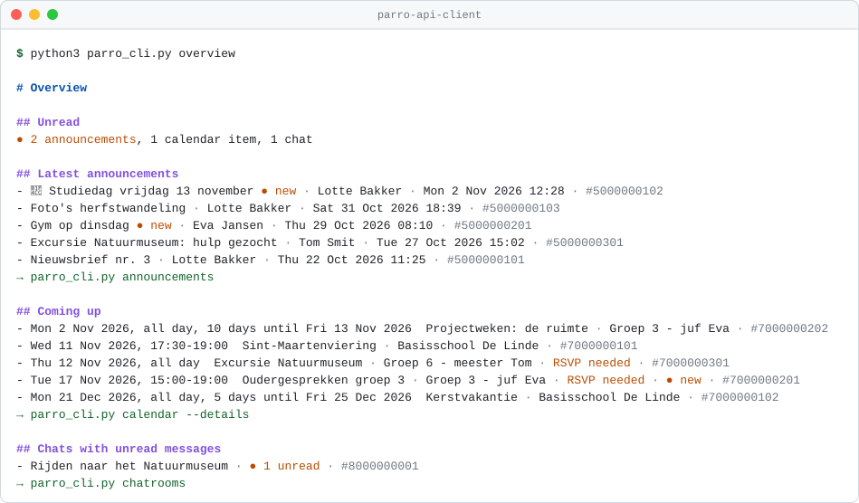
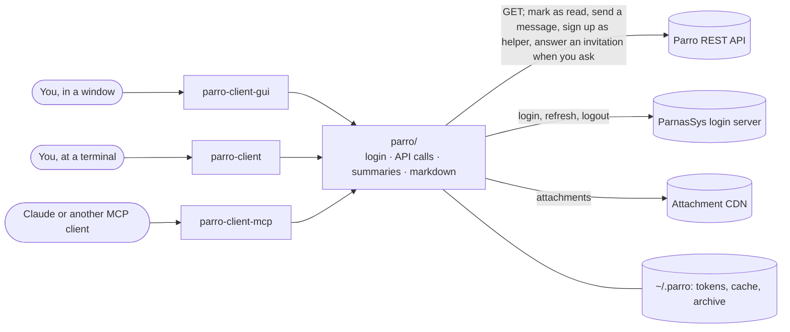
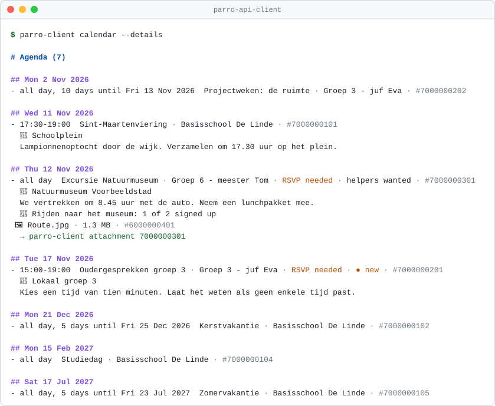
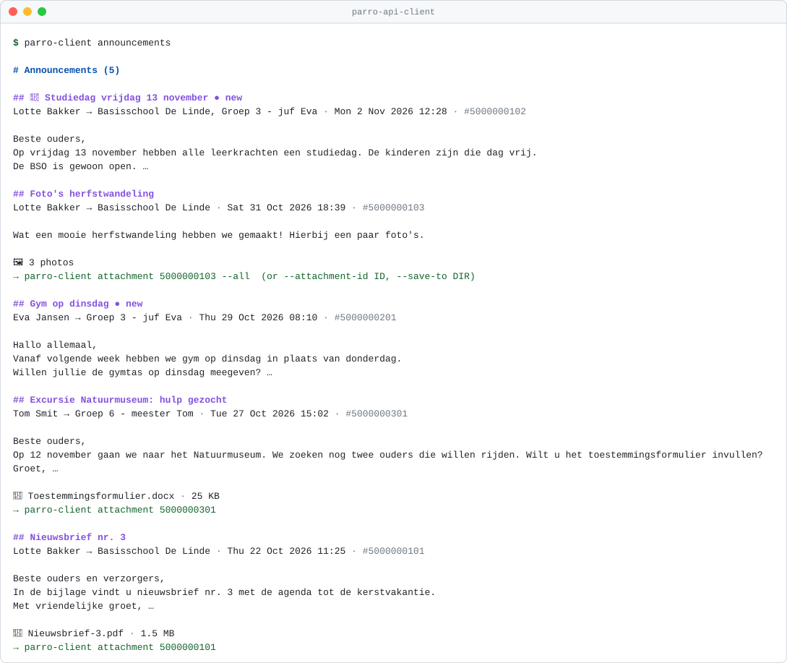
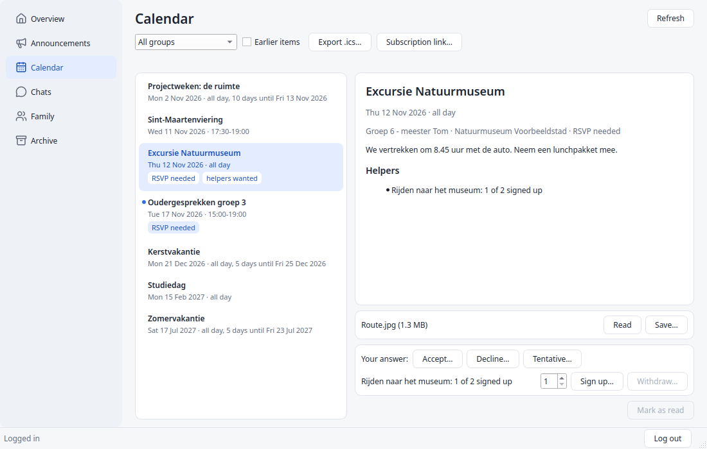
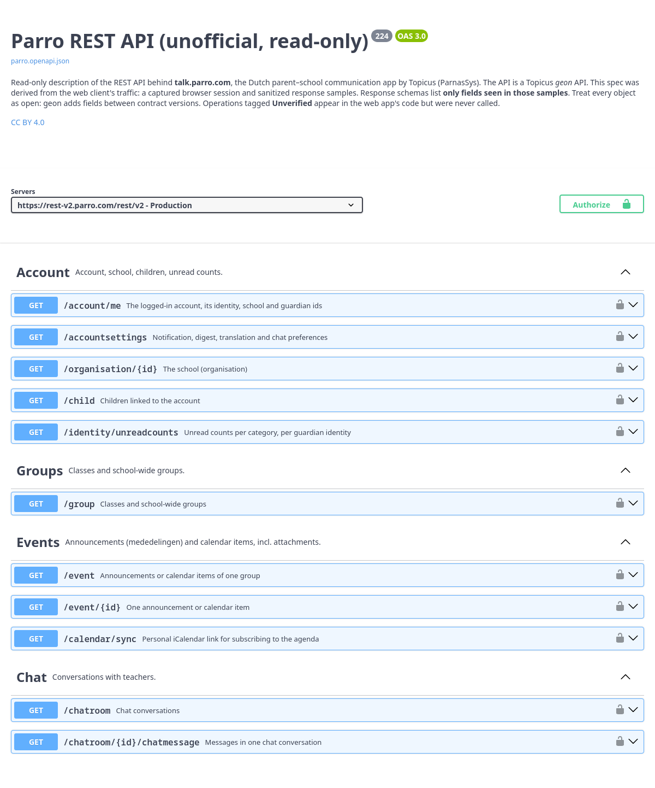

# Parro API client and OpenAPI spec

**Read your child's school news from the terminal, a desktop app or Claude:** an unofficial client and API
description for [Parro](https://talk.parro.com), the Dutch parent–school communication app by
Topicus (ParnasSys). It reads announcements, newsletters (**including the text inside PDF
attachments**), the calendar, chats and class info, and shows what you have not read yet. It can
change four things, only when you ask: mark items as read, send a text message to a chat you are
in, sign you up or withdraw you as a helper for a calendar item, and answer a calendar item's
invitation.

[](https://github.com/chris-swift-dev/parro-api-client/actions/workflows/ci.yml)
[](https://github.com/chris-swift-dev/parro-api-client/releases/latest)


[](https://github.com/chris-swift-dev/parro-api-client/blob/main/LICENSE-CODE)
[](https://github.com/chris-swift-dev/parro-api-client/blob/main/LICENSE)
[](https://m8ven.ai/mcp/chris-swift-dev-parro-api-client-1lxl3d?s=readme)

<picture>
  <source media="(prefers-color-scheme: dark)" srcset="https://raw.githubusercontent.com/chris-swift-dev/parro-api-client/main/docs/images/terminal-overview-dark.svg">
  
</picture>

<sub>All pictures in this README show invented example data from the test suite.</sub>

> Not affiliated with or endorsed by Topicus, ParnasSys or Parro. Behaviour was observed, not
> documented by the vendor, and may change at any time. Only calls seen in the Parro web app and the
> standard OAuth2 login flow are used and described.

## Quick start

1. Install it, on Windows, macOS or Linux (Python 3.10 or newer). [pipx](https://pipx.pypa.io)
   or [uv](https://docs.astral.sh/uv/) keep it in its own environment and put the commands on your
   PATH:
   ```bash
   pipx install parro-api-client
   ```
   Or `uv tool install parro-api-client`. To read PDF newsletters as text, install
   `"parro-api-client[attachments]"` instead. Straight from GitHub:
   `pipx install git+https://github.com/chris-swift-dev/parro-api-client`.
2. Log in. You type the password; the login then lasts up to 8 hours:
   ```bash
   parro-client login --prompt
   ```
3. See what is new:
   ```bash
   parro-client overview
   ```

Update with `pipx upgrade parro-api-client`. **Without installing anything:** download a release
from the [Releases page](https://github.com/chris-swift-dev/parro-api-client/releases), unpack it,
and run `python3 parro_cli.py` wherever this README says `parro-client`.

A window instead of a terminal: see [Desktop app](#desktop-app). For Claude and other MCP clients, see
[MCP server](#mcp-server). **API explorers:** the spec is
browsable in **[Swagger UI](https://chris-swift-dev.github.io/parro-api-client/)**.

## What it does

| | |
| --- | --- |
| `parro-client` | a command-line client: readable markdown at a terminal, JSON when piped (`jq`) |
| `parro-client-mcp` | an MCP server over stdio for Claude and other MCP clients |
| `parro-client-gui` | a [desktop app](#desktop-app) for Windows, macOS and Linux (optional, Python 3.12+) |
| `parro/` | the library they all use: login, API calls, summaries, attachments |
| `openapi/parro.public.openapi.json` | the OpenAPI 3.0.3 description of the API (contract version 224) |

The Parro web app talks to a Topicus "geon" REST API at `https://rest-v2.parro.com/rest/v2`. This
client speaks that API and adds three things:

1. **It strips the geon boilerplate.** A three-group list is 2.8 KB of JSON carrying about 300 bytes
   of information. Every command returns a compact summary; `--raw` (MCP: `raw: true`) gives the
   untouched payload.
2. **It reads attachments.** Newsletters arrive as PDFs; `attachment` / `parro_attachment` returns
   their text. Photos come back as images (MCP) or can be saved (CLI).
3. **It shows the data the way the app does.** Announcements once each with author and groups, an
   agenda per day, conversations in reading order, an overview of what is new. Every id stays
   visible, so the next command is always at hand.

It **reads**. It can change four things in Parro, and only when you ask for it:
mark an item as read, send a text message to a chat you are in, sign up or withdraw as a helper, and
answer an invitation: see [Changing things in Parro](#changing-things-in-parro). Apart from those three `PUT …/read` calls, the
`POST` of a message, the `POST` and `DELETE` of a helper sign-up and the `POST` of an answer, the
Parro API only receives `GET`; the other `POST` requests go to the login server's token, revoke and login-form
endpoints. Standard library only; PyMuPDF / pypdf (PDF text)
and Pillow (photo downscaling) are optional.



## What it looks like

At a terminal the CLI prints markdown; piped into another program it prints JSON. `--format` (or
`PARRO_FORMAT`) chooses explicitly. Dates are shown in the school's time zone, labels are English,
content is shown as written. Calendar items that ask parents to help (driving, reading aloud) are
marked *helpers wanted*; with `--details` you see each slot's id, how many signed up, and whether
you did.

<details>
<summary><b>The agenda</b>: <code>calendar --details</code></summary>

<picture>
  <source media="(prefers-color-scheme: dark)" srcset="https://raw.githubusercontent.com/chris-swift-dev/parro-api-client/main/docs/images/terminal-calendar-details-dark.svg">
  
</picture>
</details>

<details>
<summary><b>Announcements</b>: <code>announcements</code></summary>

<picture>
  <source media="(prefers-color-scheme: dark)" srcset="https://raw.githubusercontent.com/chris-swift-dev/parro-api-client/main/docs/images/terminal-announcements-dark.svg">
  
</picture>
</details>

[`tests/snapshots/`](https://github.com/chris-swift-dev/parro-api-client/tree/main/tests/snapshots) holds the output of every view.

## Command line

```bash
parro-client --help
parro-client login --prompt              # type the password; the login lasts up to 8 hours
parro-client status
parro-client overview                    # what is new: unread announcements, new calendar items
parro-client overview --all              # the latest announcements and everything coming up
parro-client announcements --limit 5 --unread-only
parro-client attachment <announcement-id> --text
parro-client calendar --details          # agenda with location, description and helper slots
parro-client calendar-link               # Parro's own link to subscribe from Google/Apple/Outlook
parro-client calendar --ics parro.ics --details # or: an .ics file to import
parro-client sync                        # keep a local archive (repeat to update)
parro-client privacy                     # can you still change your children's privacy choices?
parro-client chatrooms --archived include --type group
parro-client chat-messages <chatroom-id> --since 2026-10-01 --mark-read
parro-client mark-read announcement <id> # the school can see this
parro-client chat-send <chatroom-id> "Ik kan rijden op de 12e" # shows who receives it, then asks
parro-client helper signup <event-id> --count 3 # shows the slot, then asks
parro-client rsvp accept <event-id>      # or decline, tentative; shows your old and new answer, then asks
parro-client announcements --format json | jq '.announcements[].title'
parro-client get /accountsettings
parro-client token                       # paste into Swagger UI → Authorize → bearerToken
```

<details>
<summary>All commands and options</summary>

Commands: `login [--prompt]`, `logout`, `status`, `token`, `login-url`, `login-finish <url>`,
`overview [--all]`, `me`, `children`, `privacy [--link CHILD_ID]`, `groups [--previous]`, `unread`,
`system-news [--full]`, `announcements [--group ID] [--limit N] [--unread-only] [--full]`,
`announcement <id> [--mark-read]`, `calendar [--group ID] [--limit N] [--details] [--past] [--ics FILE]`,
`calendar-link`, `attachment <event-id> [--attachment-id ID | --all] [--save-to DIR] [--text]`,
`chatrooms [--unread] [--archived only|include] [--type single|bot|calendar|group|family] [--schoolyear YEAR]`,
`chat-messages <chatroom-id> [--since DATE] [--mark-read]`, `chat-members <chatroom-id> [--former]`,
`mark-read announcement|calendar|chat|group <id> [--yes]`,
`chat-send <chatroom-id> [TEXT] [--file PATH] [--yes]`,
`helper signup <event-id> [--slot ID] [--count N] [--yes]`,
`helper withdraw <event-id> [--slot ID] [--yes]`,
`rsvp accept|decline|tentative <event-id> [--yes]`, `sync [--to DIR] [--previous] [--photos]`,
`cache info|clear`, `get <path> [--param k=v ...] [--limit N] [--offset N]`.
Global options: `--format auto|json|markdown`, `--login-method`, `--raw`, `--compact`,
`--no-cache`, `--verbose`. `--full` shows whole texts instead of a 3-line preview.

Exit codes: `0` ok · `1` API/network error · `2` usage · `3` not logged in · `4` login halted.

</details>

## Desktop app

Prefer a window? `parro-client-gui` does what the command line does, on Windows, macOS and Linux. It
needs **Python 3.12 or newer**, and Qt, which adds about 300 MB:

```bash
pipx install "parro-api-client[gui]"
parro-client-gui
```

<picture>
  <source media="(prefers-color-scheme: dark)" srcset="https://raw.githubusercontent.com/chris-swift-dev/parro-api-client/main/docs/images/desktop-app-dark.png">
  
</picture>

It follows your system's light or dark setting. There is no web server or open port, and text from
others stays text. It shares its login, cache and archive with the command line. More in **[docs/DESKTOP-APP.md](https://github.com/chris-swift-dev/parro-api-client/blob/main/docs/DESKTOP-APP.md)**.

## Changing things in Parro

It reads. It can change four things, and only when you ask. Reading something never changes it. The
**[guide](https://github.com/chris-swift-dev/parro-api-client/blob/main/docs/CHANGING-THINGS.md)** has the commands, the refusals and what can be undone.

| What | Command | MCP tool and its switch | Who notices |
| --- | --- | --- | --- |
| [Mark as read](https://github.com/chris-swift-dev/parro-api-client/blob/main/docs/CHANGING-THINGS.md#marking-as-read) | `mark-read announcement <id>` | `parro_mark_read`, `PARRO_ALLOW_MARK_READ=1` | The school: read counts and read receipts |
| [Send a text message](https://github.com/chris-swift-dev/parro-api-client/blob/main/docs/CHANGING-THINGS.md#sending-a-chat-message) to a chat you are in | `chat-send <chatroom-id> "text"` | `parro_send_chat_message`, `PARRO_ALLOW_SEND_CHAT=1` | Real people, under your name. It cannot be taken back |
| [Sign up or withdraw as a helper](https://github.com/chris-swift-dev/parro-api-client/blob/main/docs/CHANGING-THINGS.md#helping-out) | `helper signup <event-id>`, `helper withdraw <event-id>` | `parro_helper_signup`, `parro_helper_withdraw`, `PARRO_ALLOW_HELPER_SIGNUP=1` | The school sees your name, and you may take the last place |
| [Answer an invitation](https://github.com/chris-swift-dev/parro-api-client/blob/main/docs/CHANGING-THINGS.md#answering-an-invitation) | `rsvp accept <event-id>` (or `decline`, `tentative`) | `parro_rsvp`, `PARRO_ALLOW_RSVP=1` | The school sees your answer. You can change it, not remove it |

Sending, signing up and answering show what would happen and ask first. Called without
`confirm: true`, their MCP tools only return that preview.

> **Think before you switch on a tool for an assistant.** An assistant also reads what other people
> write in Parro. Text in a chat or a newsletter could try to talk it into sending a message, signing
> you up or answering in your name, and whatever it can read (your children's names, school letters)
> could end up in a message. Not every one of these tools is marked as destructive, so **set your MCP
> client to ask before each of them**, and read the preview before you agree. The
> [guide](https://github.com/chris-swift-dev/parro-api-client/blob/main/docs/CHANGING-THINGS.md) has the warning for each.

## MCP server

Ask Claude about school, and it reads Parro for you. An illustration with the invented test data:

> **You:** Do I need to do anything for school in the coming weeks?
>
> **Claude** calls `parro_overview`, `parro_calendar {"details": true}` and `parro_announcement`,
> then answers:
> *Two things need a reply: the trip to the Natuurmuseum on Thursday 12 November (group 6 still
> needs two parents who can drive; there is a permission form attached) and the parent–teacher
> talks for group 3 on 17 November (pick a ten-minute slot). Friday 13 November is a study day:
> no school, but the after-school care is open.*

It has tools for announcements, attachments (including the text inside PDFs), the calendar, chats,
class info and what is new, and for logging in. The tools that change something are off unless you
switch them on: see [Changing things in Parro](#changing-things-in-parro). All 25 tools are listed in
**[docs/MCP.md](https://github.com/chris-swift-dev/parro-api-client/blob/main/docs/MCP.md)**.

With the package installed (Quick start), Claude Code:

```bash
claude mcp add parro -s user -- parro-client-mcp
```

Claude Desktop (`claude_desktop_config.json`) does not see your shell's PATH, so give the full path
of the command: `which parro-client-mcp` (Windows: `where parro-client-mcp`) prints it.

```json
{
  "mcpServers": {
    "parro": {
      "command": "/Users/you/.local/bin/parro-client-mcp",
      "env": { "PARRO_USERNAME": "you@example.com", "PARRO_PASSWORD_FILE": "/path/to/password-file" }
    }
  }
}
```

Without installing it first, [uv](https://docs.astral.sh/uv/) can start it on demand:
`"command": "uvx", "args": ["--from", "parro-api-client", "parro-client-mcp"]` (also with the full
path of `uvx` for Claude Desktop). From an unpacked release:
`"command": "python3", "args": ["/path/to/parro-api-client/parro_mcp.py"]`.

Testing without an MCP client: `parro-client-mcp tools`, then
`parro-client-mcp call parro_announcements '{"limit": 5}'`. PDF text needs **PyMuPDF** or
**pypdf**, photo downscaling **Pillow** (installed with `"parro-api-client[attachments]"`); without them
everything else works, and the attachment tool says what to install. Running it in Docker:
[DEPLOY.md](https://github.com/chris-swift-dev/parro-api-client/blob/main/DEPLOY.md).

## Logging in

Logging in is OAuth2 against the ParnasSys login server. By default the client does exactly what a
browser does (the login form); tokens are stored in `~/.parro-mcp/tokens.json` (mode 0600) and
refresh themselves, but **a login lasts at most 8 hours**: the login server's limit, however often
the client refreshes. After that, log in again. With `PARRO_USERNAME` and a password file set, the
client (and the MCP server) logs in again on its own when needed: one password check per 8 hours.
`parro-client status` (MCP: `parro_auth_status`) shows until when the current login lasts.

> **The login server locks the account after a few failed logins.** When a password is rejected,
> the client stops logging in on its own, so a typo costs one attempt, not one per call. `status`
> then shows `automatic_login_halted`; fix the password and run `parro-client login` once.

Credentials: `PARRO_USERNAME` plus `PARRO_PASSWORD_FILE` (or `PARRO_PASSWORD`), or
`login --prompt`, or no password at all with `login-url` / `login-finish`. Login methods, the
lockout latch and why there is no automatic browser redirect: **[docs/LOGIN.md](https://github.com/chris-swift-dev/parro-api-client/blob/main/docs/LOGIN.md)**.
Every environment variable: **[docs/CONFIGURATION.md](https://github.com/chris-swift-dev/parro-api-client/blob/main/docs/CONFIGURATION.md)**.

## Also in the box

- **The agenda in your own calendar app:** `calendar-link` prints Parro's own subscription link (a
  secret), and `calendar --ics FILE` writes an iCalendar file.
- **Your children's privacy choices:** `privacy` shows per child whether you can still change them,
  and when and by whom they were last changed.
- **Your own archive:** `sync` keeps a local copy of everything your account can see, as files that
  stay readable without Parro.

All three are explained in **[docs/CALENDAR-AND-ARCHIVE.md](https://github.com/chris-swift-dev/parro-api-client/blob/main/docs/CALENDAR-AND-ARCHIVE.md)**.

## The OpenAPI specification

<a href="https://chris-swift-dev.github.io/parro-api-client/"></a>

[`openapi/parro.public.openapi.json`](https://github.com/chris-swift-dev/parro-api-client/blob/main/openapi/parro.public.openapi.json) describes the API as
observed from the web client: 34 operations of the Parro API and the login server's OAuth2 endpoints,
each seen in a live call or a capture of the web app. **[openapi/README.md](https://github.com/chris-swift-dev/parro-api-client/blob/main/openapi/README.md)**
says what it covers and how it is generated; [docs/API-NOTES.md](https://github.com/chris-swift-dev/parro-api-client/blob/main/docs/API-NOTES.md) lists the
facts the client relies on.

- **"Try it out"** works once you paste an access token into **Authorize → bearerToken**
  (`parro-client token` prints one).
- **Don't log in through Swagger UI.** The code flow can't complete there, and failed password
  attempts count toward the account lockout.

## FAQ

**Is this an official Parro tool?** No. It is not affiliated with or endorsed by Topicus, ParnasSys
or Parro. It uses the same API calls as the Parro web app, as observed from that app.

**Can it post, change or delete anything in Parro?** It can do four things, and only when you
ask: [mark an item as read](https://github.com/chris-swift-dev/parro-api-client/blob/main/docs/CHANGING-THINGS.md#marking-as-read), [send a text message](https://github.com/chris-swift-dev/parro-api-client/blob/main/docs/CHANGING-THINGS.md#sending-a-chat-message)
to a chat you are in, [sign up or withdraw as a helper](https://github.com/chris-swift-dev/parro-api-client/blob/main/docs/CHANGING-THINGS.md#helping-out), and
[answer an invitation](https://github.com/chris-swift-dev/parro-api-client/blob/main/docs/CHANGING-THINGS.md#answering-an-invitation). Assistants can do these only if you switch that
on, separately for each. Apart from taking back your own helper sign-up, it cannot delete anything,
and it cannot start new chats or send attachments. Those are three fixed `PUT …/read` calls, three
fixed `POST` calls and one fixed `DELETE`; every other request to the Parro
API is a `GET`, and the other `POST` requests go to the login server (logging in, refreshing,
logging out).

**Where does my password go?** Only to the ParnasSys login server, the same one the web app uses.
`login --prompt` stores nothing but the tokens (`~/.parro-mcp/tokens.json`, readable only by you);
`logout` revokes them. With `login-url` the client never sees a password at all. Passwords, tokens
and download links are never written to a log.

**Can a wrong password lock my account?** The login server locks an account after a few failed
attempts, so the client never retries: after one rejected password it stops logging in until you
run `login` yourself. See [docs/LOGIN.md](https://github.com/chris-swift-dev/parro-api-client/blob/main/docs/LOGIN.md#the-lockout-latch).

**What leaves my computer?** Only requests to Parro, its login server and its attachment CDN. There
is no telemetry. Note that with the MCP server, whatever a tool returns (school news, your
children's names, documents) goes to the AI assistant you use, and so to its provider.

**Does it work for every school?** It was tested with one parent account. The calendar
subscription link is part of the paid *Parro Ouderapp*, so it may not work everywhere; the rest uses
the same calls as the web app. Parro can change its API at any time; if something breaks, please
open an issue. Security problems: please report them privately, see [SECURITY.md](https://github.com/chris-swift-dev/parro-api-client/blob/main/SECURITY.md).

## Development

```bash
python3 -m venv .venv && .venv/bin/pip install -r requirements-test.txt
.venv/bin/pytest            # no network: fake login server and API, invented family and school
.venv/bin/ruff check . && .venv/bin/mypy
```

Repository layout, snapshots, the README pictures and making a release:
[docs/DEVELOPMENT.md](https://github.com/chris-swift-dev/parro-api-client/blob/main/docs/DEVELOPMENT.md). A walk through the code:
[docs/CODE-TOUR.md](https://github.com/chris-swift-dev/parro-api-client/blob/main/docs/CODE-TOUR.md). How each release was checked against the real API:
[docs/LIVE-CHECKS.md](https://github.com/chris-swift-dev/parro-api-client/blob/main/docs/LIVE-CHECKS.md).

## Credits

Inspired by **[fobatai/parro-mcp](https://github.com/fobatai/parro-mcp)**, a read-only MCP server for
Parro by fobatai. Its working login and API calls were the starting point for this follow-up. The
client here is an independent implementation based on the OpenAPI specification in this repository.

The desktop app's icons are from [Lucide](https://lucide.dev) ([ISC licence](https://github.com/chris-swift-dev/parro-api-client/blob/main/parro_gui/icon_files/LICENSE)).

## License

- **Code** (`parro/`, `parro_gui/`, `parro_cli.py`, `parro_mcp.py`, `tests/`, `tools/`): [MIT](https://github.com/chris-swift-dev/parro-api-client/blob/main/LICENSE-CODE).
- **Specification and documentation** (`openapi/`, `docs/`, the README files):
  [Creative Commons Attribution 4.0 International (CC BY 4.0)](https://creativecommons.org/licenses/by/4.0/)
  (see [`LICENSE`](https://github.com/chris-swift-dev/parro-api-client/blob/main/LICENSE)). You may share and adapt them for any purpose, provided you give
  appropriate credit (link to this repository), indicate the license and note any changes you made.

"Parro", "ParnasSys" and "Topicus" are names of their respective owners. They are used here only to
identify the API being described.
