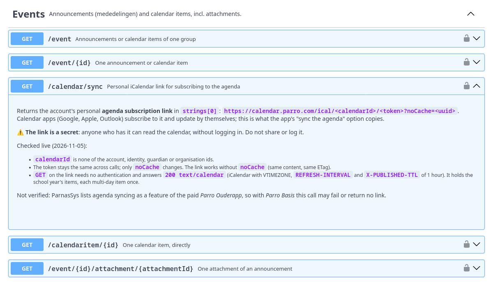

# Parro OpenAPI spec

`parro.openapi.json`: OpenAPI 3.0.3, contract version 224. Import it into
https://editor.swagger.io (File → Import file). "Try it out" works with a pasted bearer
token. Logging in through Swagger UI's OAuth2 dialog does not work (see the warning in the spec).

## What it covers

34 operations of the Parro API (account, children and their privacy settings, groups, announcements,
calendar items, chats with their filters and members, unread counts, system news, absence and
photo-export settings, the agenda subscription link, the three calls that mark items as read, sending
a chat message, signing up and withdrawing as a helper, and answering an invitation), each seen in a
live call or a capture of the web app, and the login server's OAuth2 endpoints. It explains the
non-obvious parts: the geon media type and headers, `Range`-based paging, `dtype` polymorphism, which
id opens a chat, and where attachments live.

Response schemas contain **only fields seen in real responses**; the published spec carries no
example payloads.

<details>
<summary>An operation in Swagger UI: <code>GET /calendar/sync</code></summary>


</details>

## Rebuilding

The spec is generated. **Don't edit the JSON by hand**: change `tools/build_spec.py` or add samples.

```bash
npm run spec    # both specs: openapi/parro.openapi.json (full) + openapi/parro.public.openapi.json
                # = python3 tools/build_spec.py && python3 tools/build_spec.py --public --out openapi/parro.public.openapi.json
```

- Operations, parameters, auth and descriptions are written by hand in `tools/build_spec.py`.
- Response schemas are inferred from `samples/*.json`: one schema per geon `dtype`, containing only
  fields seen in a sample. New samples widen the schemas automatically.
- Each sample is embedded as a response example. The build warns about samples it doesn't use.
- Sample naming: `<operationId>[_<variant>].<status>.json`. A new sample must also be listed in the
  matching `op(...)` call to become an example.

## Validating

```bash
python3 -m venv .venv && .venv/bin/pip install openapi-spec-validator openapi-schema-validator rfc3987
.venv/bin/python tools/validate_spec.py                     # structure, examples vs schemas, privacy scan
npm ci --ignore-scripts && npx redocly lint --config redocly.yaml openapi/parro.openapi.json
```

Last run (2026-11-05): spec valid; 26/26 examples match their schemas, with format checking on;
privacy scan clean (it also checks that every name, address and signed link in the examples and in
`samples/` is a placeholder, see `tools/privacy_scan.py`). Redocly runs in the Pages workflow (last local run 2026-11-04: 0 errors, 0
warnings). The spec also renders in Swagger UI 5.

## Publishing on GitHub Pages

The public site serves **`parro.public.openapi.json`**: the same spec without any sample-derived
examples. `.github/workflows/pages.yml` runs on every push and pull request:

1. If `samples/` is committed: regenerate both specs and fail if the committed ones are stale.
2. Validate both specs (`tools/validate_spec.py` + Redocly).
3. On `main` only: assemble the site (`tools/build_site.sh`: stock `swagger-ui-dist` + `site/swagger-initializer.js`
   + the public spec) and deploy it with `actions/deploy-pages`.

Swagger UI and Redocly are pinned in `package.json`. Dependabot (`.github/dependabot.yml`) opens PRs for new
versions of them, of the workflow's actions and of the Python validators. No Swagger UI files are vendored.

**One-time setup**
1. Decide visibility. **Pages sites are always public**, and Pages on a *private* repo needs a paid plan.
   For a **public** repo, first uncomment `samples/` and `openapi/parro.openapi.json` in `.gitignore`.
   CI then skips the steps that need them.
2. Create an empty repo on GitHub (no README), then here:
   ```bash
   git add -A && git status        # check: no samples/ or full spec if the repo is public
   git commit -m "Parro OpenAPI spec + Swagger UI on GitHub Pages"
   git remote add origin git@github.com:<you>/<repo>.git
   git push -u origin main
   ```
3. GitHub → repo **Settings → Pages → Build and deployment → Source: GitHub Actions**.
4. Re-run the workflow (Actions tab), or push again. The site is at `https://<you>.github.io/<repo>/`.

**Preview locally:** `npm ci --ignore-scripts && npm run preview`, then open http://localhost:8000.
